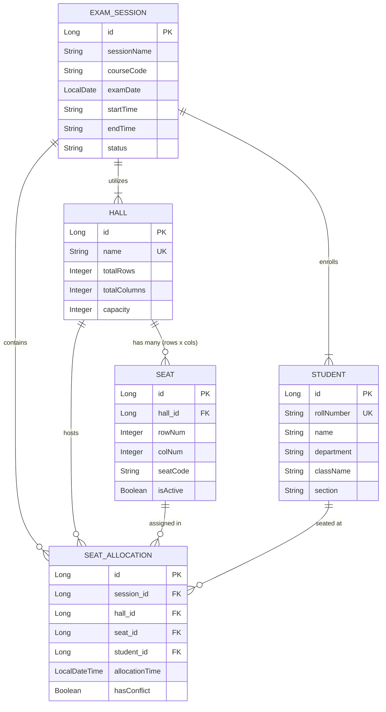

# 🪑 SeatPlan — Exam Hall Seating Arrangement Generator

> **Question 38: SeatPlan** — A production-ready Spring Boot backend & web application that auto-generates exam seating plans across halls, strictly preventing students of the same class/section from sitting in adjacent seats while strictly enforcing hall declared capacity limits.

---

## 🚀 Key Features

1. **Register Exam Halls**
   - Configure halls with rows, columns, and declared capacity.
   - Dynamic validation ensures declared capacity does not exceed physical seats ($rows \times columns$).
   - Automatic generation of 2D seat coordinates (e.g. `R1C1`, `R1C2`).

2. **Register Students**
   - Register examinees individually or via bulk registration with roll number, name, department, class, and section.
   - Enforces unique roll number validation with `409 Conflict` error handling.

3. **Intelligent Auto-Allocation Algorithm**
   - **Declared Capacity Rule**: Strictly checks total students vs. declared capacity in the service layer before saving. Rejects invalid requests with `400 Bad Request` (`InsufficientCapacityException`).
   - **Non-Adjacent Constraint Satisfaction**: Uses a greedy constraint-satisfaction heuristic with Most-Constrained-First priority:
     - Detects adjacent neighbors (horizontal and vertical) for every seat.
     - Selects candidate sections with no adjacent conflict, choosing the section with the largest remaining student pool.
     - Avoids adjacent placement of students from the same section whenever alternatives exist.

4. **Printable Seating Chart Per Hall**
   - Generates JSON seating matrix and print-optimized HTML notice board charts (`GET /api/allocations/sessions/{sessionId}/halls/{hallId}/chart/print`).
   - Equipped with `@media print` CSS for standard exam hall notice boards.

5. **Student Seat Lookup**
   - Instant query endpoint (`GET /api/allocations/student/{rollNumber}`) for examinees to locate their assigned exam session, hall name, row, column, and seat code.

6. **Rich Web Dashboard**
   - Modern glassmorphism UI served at `http://localhost:8080/` with interactive 2D seating grids, section color coding, live audit logs, and search filters.

7. **Audit & Notification Stream**
   - Logs status changes to the console and persists notification records for full auditing (`GET /api/notifications`).

---

## 🏗️ Architecture & Database Design

### Entity Relationship Model



---

## 🛡️ Business Rules Enforced in Service Layer

| Rule | Enforcement Location | Behavior When Violated | HTTP Code |
| :--- | :--- | :--- | :--- |
| **No student allocated beyond hall capacity** | `SeatAllocationService.autoAllocateSeats()` | Rejects immediately with clear explanation before touching DB | `400 Bad Request` |
| **Declared capacity $\le$ physical seats** | `HallService.createHall()` & `updateHall()` | Rejects if declared capacity exceeds $rows \times cols$ | `400 Bad Request` |
| **Non-adjacent same-section seating** | `SeatAllocationService.allocateHallSeats()` | Selects alternative sections; only flags unavoidable conflicts if 0 alternatives exist | Enforced |
| **Duplicate Student Roll Number** | `StudentService.registerStudent()` | Prevents duplicate student record creation | `409 Conflict` |
| **Non-existent Resource Queries** | All Services | Returns structured JSON error instead of stack traces | `404 Not Found` |

---

## 📡 REST API Reference

### 1. Exam Halls (`/api/halls`)
- `POST /api/halls` — Register a new hall (`name`, `totalRows`, `totalColumns`, `capacity`).
- `GET /api/halls` — List all registered halls.
- `GET /api/halls/paged?page=0&size=10&sortBy=name` — Paged & sorted hall list.
- `GET /api/halls/{id}` — Get hall by ID.
- `PUT /api/halls/{id}` — Update hall dimensions and capacity.
- `DELETE /api/halls/{id}` — Delete hall.

### 2. Students (`/api/students`)
- `POST /api/students` — Register a student (`rollNumber`, `name`, `department`, `className`, `section`).
- `POST /api/students/bulk` — Bulk register students.
- `GET /api/students` — Retrieve all students.
- `GET /api/students/search?search={query}&page=0&size=15` — Paged search by roll, name, or class.
- `GET /api/students/roll/{rollNumber}` — Get student by roll number.
- `DELETE /api/students/{id}` — Delete student.

### 3. Exam Sessions (`/api/sessions`)
- `POST /api/sessions` — Schedule exam session (`sessionName`, `courseCode`, `examDate`, `startTime`, `endTime`, `hallIds`).
- `GET /api/sessions` — List all exam sessions.
- `GET /api/sessions/{id}` — Get session details with hall capacities.
- `PATCH /api/sessions/{id}/status?status=ALLOCATED` — Update session status.
- `DELETE /api/sessions/{id}` — Delete session.

### 4. Auto-Allocation & Seating (`/api/allocations`)
- `POST /api/allocations/auto-allocate` — Run auto-allocation algorithm for an exam session.
- `GET /api/allocations/sessions/{sessionId}/halls/{hallId}/chart` — 2D JSON seating grid.
- `GET /api/allocations/sessions/{sessionId}/halls/{hallId}/chart/print` — HTML notice board chart.
- `GET /api/allocations/student/{rollNumber}` — Student seat lookup.
- `DELETE /api/allocations/sessions/{sessionId}` — Reset allocations for a session.

### 5. Notifications & Audit (`/api/notifications`)
- `GET /api/notifications` — Retrieve the 50 most recent system audit logs.

---

## 🧪 Testing

The test suite includes 9 automated JUnit and MockMvc tests covering both normal execution and edge cases:

```powershell
.\mvnw.cmd test
```

### Verified Test Cases:
1. `testCapacityExceededRule`: Asserts that assigning students beyond declared capacity throws `InsufficientCapacityException` (`400 Bad Request`).
2. `testAdjacentSeatingRule`: Validates that horizontal and vertical neighbors differ in section with 0 unavoidable conflicts.
3. `testStudentSeatLookup`: Verifies that querying by roll number returns the exact hall name, row, column, and seat code.
4. `testDuplicateStudentRollNumber`: Rejects duplicate roll numbers with `DuplicateResourceException` (`409 Conflict`).
5. `testHallValidationFailure`: Validates `@NotNull` and `@Positive` constraints on input payloads.
6. `testStudentNotFound`: Validates `404 Not Found` response format.

---

## 💻 Running Locally

### Option 1: Embedded H2 (Default, Zero-Setup)
The application is pre-configured with embedded H2 for instant local execution without installing MySQL:
```powershell
.\mvnw.cmd spring-boot:run
```
- Web Application: [http://localhost:8080/](http://localhost:8080/)
- H2 Console: [http://localhost:8080/h2-console](http://localhost:8080/h2-console) (JDBC URL: `jdbc:h2:file:./data/seatplandb`, Username: `sa`, Password: *blank*)

### Option 2: MySQL Profile
To run against your local MySQL database:
1. Set the active profile to `mysql` in `src/main/resources/application.properties` or launch with:
```powershell
.\mvnw.cmd spring-boot:run -Dspring-boot.run.profiles=mysql
```
